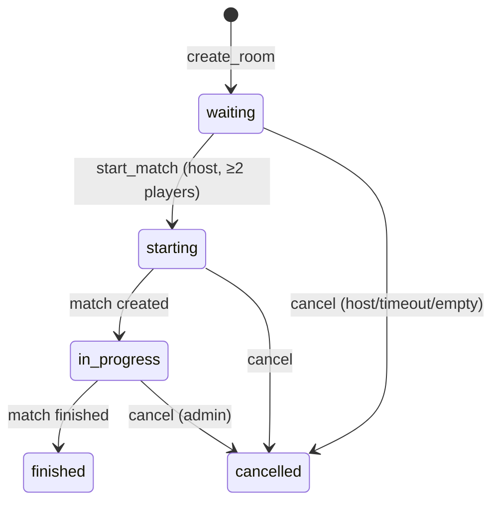
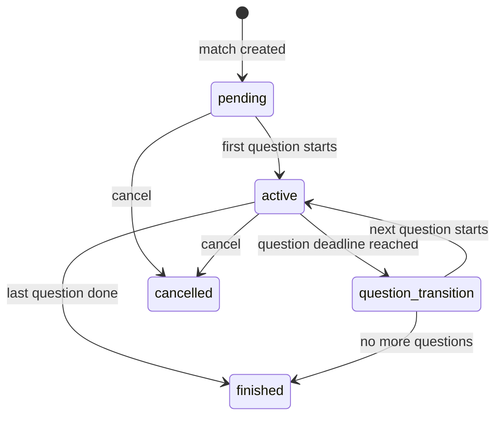
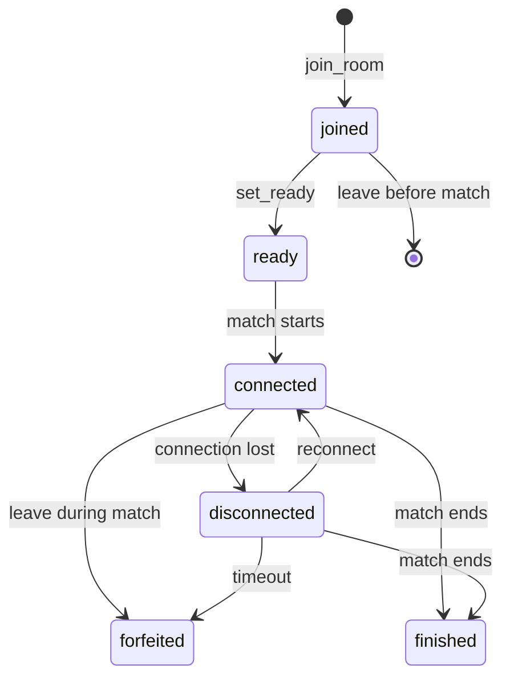

# Architecture — Violympus

## Stack Overview

| Layer | Technology |
|---|---|
| UI | React 19 + TypeScript (strict) |
| Build | Vite 8 |
| Routing | React Router v7 |
| Styling | Tailwind CSS v4 + shadcn/ui |
| Icons | Lucide React |
| Server state | TanStack Query v5 |
| Client state | Zustand (minimal) |
| Forms | React Hook Form + Zod |
| i18n | i18next + react-i18next |
| Backend | Supabase (Postgres, Auth, Realtime, RPC) |
| Testing | Vitest + RTL (unit/component), Playwright (E2E) |
| Deploy | Vercel |

## Module Structure

```
src/
├── app/                    # Application shell
│   ├── router/             # Route config + guards
│   ├── providers/          # QueryClient, i18n, auth, error boundary
│   └── layouts/            # PublicLayout, AppLayout, ExamLayout, AdminLayout
├── components/
│   ├── ui/                 # shadcn/ui primitives
│   └── shared/             # Cross-feature components
├── features/               # Feature modules (barrel exports)
│   ├── auth/
│   ├── dashboard/
│   ├── subjects/
│   ├── learning/
│   ├── questions/
│   ├── practice/
│   ├── exams/
│   ├── arena/
│   ├── tournaments/
│   ├── leaderboard/
│   ├── profile/
│   ├── settings/
│   └── admin/
├── hooks/                  # Shared hooks
├── services/               # API/RPC shared client
├── lib/
│   ├── supabase/           # Client + generated types
│   ├── i18n/               # Config + resources vi/en
│   ├── validation/         # Shared Zod schemas
│   ├── utils/              # Utilities (cn, formatting)
│   └── errors/             # AppError, codes, reportError
├── types/                  # Shared types
└── test/                   # Setup, fixtures, helpers
```

## Data Flow

```
User Action
  → React Component (event handler)
    → Service layer (RPC call via Supabase client)
      → TanStack Query mutation/query
        → Supabase Edge (RLS + RPC)
          → PostgreSQL (source of truth)
            → Realtime broadcast (after commit)
              → Client subscription (useArenaRealtime)
                → UI update (via query invalidation or local state)
```

### Trust Boundary

```
┌─────────────────────────────────────────┐
│              CLIENT (untrusted)          │
│  React UI → Service → Supabase JS SDK   │
└──────────────┬──────────────────────────┘
               │ HTTPS (anon key)
┌──────────────▼──────────────────────────┐
│             SERVER (trusted)             │
│  Supabase Auth → RLS → RPC → Postgres   │
│  - Validates auth.uid()                  │
│  - Enforces RLS policies                 │
│  - Server timestamps for deadlines       │
│  - Scores answers server-side            │
│  - XP granted via idempotent RPC         │
└─────────────────────────────────────────┘
```

**Client NEVER:**
- Computes official scores
- Writes to results/answers/XP tables directly
- Receives answer keys before permitted
- Sets deadlines or timestamps used for scoring
- Determines role/permissions

---

## Arena State Machine

### Room States



### Match States



### Participant States



### Transition Table (TypeScript constants)

```typescript
// Canonical transition maps — used in both client validation and SQL checks
const ROOM_TRANSITIONS: Record<RoomStatus, RoomStatus[]> = {
  waiting: ['starting', 'cancelled'],
  starting: ['in_progress', 'cancelled'],
  in_progress: ['finished', 'cancelled'],
  finished: [],
  cancelled: [],
};

const MATCH_TRANSITIONS: Record<MatchStatus, MatchStatus[]> = {
  pending: ['active', 'cancelled'],
  active: ['question_transition', 'finished', 'cancelled'],
  question_transition: ['active', 'finished', 'cancelled'],
  finished: [],
  cancelled: [],
};

const PARTICIPANT_TRANSITIONS: Record<ParticipantStatus, ParticipantStatus[]> = {
  joined: ['ready'],
  ready: ['connected'],
  connected: ['disconnected', 'forfeited', 'finished'],
  disconnected: ['connected', 'forfeited', 'finished'],
  forfeited: [],
  finished: [],
};

function canTransition<T extends string>(
  transitions: Record<T, T[]>,
  from: T,
  to: T,
): boolean {
  return transitions[from]?.includes(to) ?? false;
}
```

### Concurrency Control

- `arena_matches.state_version` increments on every state transition
- `advance_match(match_id, expected_version, expected_question_index)`:
  - `SELECT ... FOR UPDATE` on match row
  - Compare `state_version` and `current_question_index`
  - If mismatch → return `STALE_STATE` error → client refetches snapshot
- Prevents two concurrent `advance_match` calls from double-advancing

### Reconnect Flow

1. Client detects disconnect (Supabase Realtime `CLOSED`/`TIMED_OUT`)
2. Show "Reconnecting..." banner, disable answer submission
3. On reconnect: call `get_match_snapshot(match_id)` or `get_room_snapshot(room_code)`
4. Compare local `state_version` with server's
5. If server version > local: update local state from snapshot
6. Re-subscribe to Realtime channel
7. Show "Synced" banner briefly
8. Ignore Realtime events with `state_version <= local_version`

### Host Transfer

1. `heartbeat` RPC updates `arena_participants.last_seen_at`
2. If host `last_seen_at` > 30s ago (checked by other participant's heartbeat or advance_match):
   - Promote participant with earliest `joined_at` who is still `connected`
   - Update `arena_rooms.host_user_id`
   - Broadcast host change event
3. If no connected participants remain → room cancelled

---

## Scoring Rules

### Solo Exam Scoring

| Question Type | Scoring Rule |
|---|---|
| `single_choice` | Correct option selected → full points; else 0 |
| `true_false` | Correct → full points; else 0 |
| `short_text` | Normalized answer matches any accepted answer → full points; else 0 |
| `multi_select` | All-or-nothing: exact set match → full points; else 0 |

### Short Text Normalization

```
input → trim() → Unicode NFC → toLowerCase() → collapse whitespace
```

- **Do NOT** remove Vietnamese diacritics (changes meaning: "cá" ≠ "ca")
- `case_sensitive` flag: skip toLowerCase()
- `exact` flag: skip all normalization
- Documented and unit-tested

### Arena Scoring (MVP: speed bonus OFF)

- Correct answer: points configured per question
- Wrong/skip: 0 points (no negative scoring unless rules explicitly state)
- Speed bonus (disabled by default): `points × (1 + bonus_factor × remaining_seconds / time_limit_seconds)`, rounded to integer deterministically (`Math.round`)

### Tie-Break (Deterministic)

Order of precedence:
1. Total score ↓
2. Number of correct answers ↓
3. Total time spent on correct answers ↑ (faster is better)
4. `user_id` lexicographic (stable, last resort)

Displayed to players in "Rules" section.

### XP Rules

- XP ≠ exam score
- Sources: completed attempt (valid), arena match finished
- Idempotency key: `{source_type}:{source_id}:{user_id}`
- Daily cap per source type (configurable, e.g., 500 XP/day from practice)
- Anti-farm: attempts completed in < 10% of expected time or with 0 answers → no XP
- XP values (MVP defaults):
  - Practice attempt completed: 10 XP
  - Timed exam completed: 20 XP
  - Arena match completed: 30 XP
  - Arena match won: +20 XP bonus

---

## Key Design Decisions

1. **PostgreSQL as source of truth** — Realtime is notification layer only
2. **Server-side scoring** — Client never computes official results
3. **Server timestamps** — All deadlines use `now()` in RPC, not client time
4. **Snapshot-based reconnect** — Not event replay
5. **Idempotent mutations** — Unique constraints + ON CONFLICT for safe retries
6. **No AI in MVP** — Architecture allows future extension
7. **Lazy-resolution for stuck rooms** — No pg_cron dependency; RPCs check and resolve expired states
